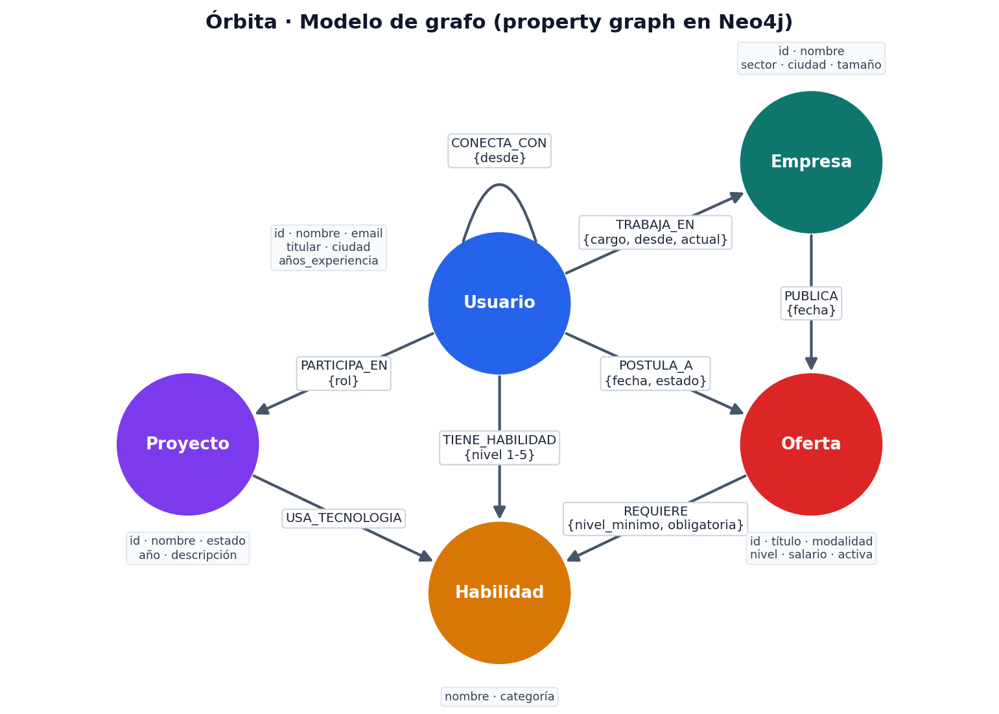
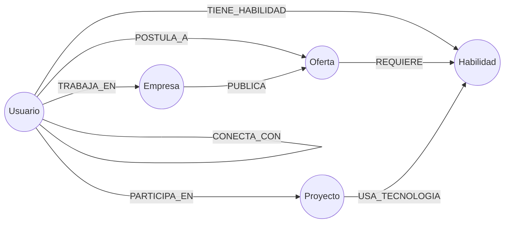

# Diseño e implementación de una aplicación basada en base de datos de grafos para la gestión y análisis de relaciones en una red profesional

**Bases de Datos · 202630-2424 — Proyecto de Investigación y Desarrollo (I+D)**
**Tema:** Bases de datos no relacionales — Bases de datos orientadas a grafos
**Aplicación:** Órbita · Red Profesional (Python + Streamlit + Neo4j AuraDB)

**Integrantes:**
- Juan Diaz
- Manuela Maiguel
- Alex Teran

**Noviembre de 2026**

---

## Objetivos

- Afianzar los conocimientos de diseño y modelamiento de bases de datos no relacionales.
- Demostrar la utilidad de las bases de datos de grafos en escenarios donde predominan las relaciones múltiples y dinámicas entre entidades, evidenciando sus ventajas frente a modelos tradicionales en tareas de análisis de redes y recomendación.

---

## 1. Introducción a las bases de datos orientadas a grafos

Una **base de datos orientada a grafos** almacena la información como un conjunto de **nodos** (entidades) y **relaciones** (aristas) que los conectan. Tanto nodos como relaciones pueden tener **propiedades** (pares clave-valor). Este modelo se conoce como **grafo de propiedades etiquetado** (*labeled property graph*):

| Elemento | Significado | Ejemplo en Órbita |
|---|---|---|
| Nodo | Entidad | Una persona, una empresa |
| Etiqueta | Tipo o rol del nodo | `:Usuario`, `:Empresa`, `:Oferta` |
| Relación | Conexión **dirigida y con tipo** entre dos nodos | `(:Usuario)-[:TRABAJA_EN]->(:Empresa)` |
| Propiedad | Atributo de un nodo o relación | `nombre`, `nivel`, `cargo`, `desde` |

La característica fundamental es la **adyacencia libre de índices** (*index-free adjacency*): cada nodo guarda referencias físicas directas a sus relaciones. Por eso, pasar de un nodo a sus vecinos cuesta un tiempo proporcional al número de vecinos visitados y **no depende del tamaño total de la base**. En una base relacional, la misma operación exige un `JOIN`, es decir, buscar en índices o tablas completas cada vez que se cruza una relación.

Como consecuencia:

- Las consultas de **recorrido** (amigos de amigos, caminos, vecindarios) se expresan con patrones visuales y se ejecutan de forma eficiente aunque crezca la profundidad.
- El esquema es **flexible**: se pueden agregar nuevos tipos de relación (como `USA_TECNOLOGIA` en este proyecto) sin migraciones costosas.
- El modelo conceptual (un diagrama de entidades y relaciones en una pizarra) **coincide con el modelo físico**.

Las familias principales de bases NoSQL son las de clave-valor, documentales, columnares y de grafos. Las de grafos se especializan en datos **altamente interconectados**: redes sociales y profesionales, detección de fraude, motores de recomendación, gestión de identidades y accesos, cadenas de suministro, grafos de conocimiento y telecomunicaciones.

**Cypher** es el lenguaje declarativo de consulta de Neo4j, base del estándar ISO **GQL** (2024). Describe patrones con notación de "arte ASCII":

```cypher
// Contactos de mis contactos que trabajan en una empresa
MATCH (yo:Usuario {id: $id})-[:CONECTA_CON]-(:Usuario)-[:CONECTA_CON]-(x:Usuario)-[:TRABAJA_EN]->(e:Empresa)
RETURN x.nombre, e.nombre
```

---

## 2. Justificación de Neo4j

Se eligió **Neo4j** (en su servicio administrado **AuraDB Free**) por estas razones:

1. **Grafo nativo:** el almacenamiento y el motor de consultas están diseñados para grafos (adyacencia libre de índices), a diferencia de soluciones multimodelo que simulan grafos sobre tablas o documentos.
2. **Cypher:** lenguaje declarativo y expresivo, con funciones integradas de caminos (`shortestPath`, `allShortestPaths`), subconsultas `COUNT {}`, `COLLECT {}` y `EXISTS {}`, y patrones de longitud variable (`*..8`).
3. **Transacciones ACID** y **restricciones de unicidad**, necesarias para un sistema de registro (correo único, identificadores únicos).
4. **AuraDB Free:** servicio en la nube sin instalación ni costo, accesible por el protocolo cifrado `neo4j+s://`. Es adecuado para un proyecto académico.
5. **Ecosistema:** controlador oficial de Python (`neo4j`), Neo4j Browser para inspección visual y amplia documentación y comunidad.
6. **Madurez:** es el sistema de grafos más usado según el ranking DB-Engines y participa en la estandarización de GQL.

**Limitación considerada:** AuraDB Free **no incluye la biblioteca Graph Data Science (GDS)** (PageRank, Louvain, etc. del lado del servidor), y así se verificó en la instancia (`gds.version()` falla). Por eso, las métricas de centralidad avanzada y la detección de comunidades se calculan en la aplicación con NetworkX, sobre el subgrafo extraído **en tiempo real** con Cypher (sección 6.5).

---

## 3. Descripción del modelo de nodos y relaciones

### 3.1 Nodos

| Etiqueta | Clave única | Propiedades | Descripción |
|---|---|---|---|
| `Usuario` | `id`, `email` | nombre, titular, ciudad, teléfono, anios_experiencia, nivel_educativo, resumen, fecha_registro | Persona registrada en la plataforma |
| `Empresa` | `id`, `nombre` | sector, ciudad, tamano, sitio_web, descripcion | Organización o compañía |
| `Habilidad` | `nombre` | categoria | Competencia o conocimiento |
| `Proyecto` | `id` | nombre, descripcion, estado, anio | Trabajo o iniciativa desarrollada |
| `Oferta` | `id` | titulo, descripcion, ciudad, modalidad, nivel, salario, activa, fecha_publicacion | Vacante laboral |

### 3.2 Relaciones

| Relación | Patrón | Propiedades | Significado |
|---|---|---|---|
| `CONECTA_CON` | `(Usuario)-(Usuario)` | desde | Conexión profesional. **Simétrica**: se guarda una sola vez y se consulta sin dirección `-[:CONECTA_CON]-`. |
| `TRABAJA_EN` | `(Usuario)->(Empresa)` | cargo, desde, actual | Vínculo laboral actual o pasado |
| `TIENE_HABILIDAD` | `(Usuario)->(Habilidad)` | nivel (1-5) | El usuario posee la habilidad |
| `PARTICIPA_EN` | `(Usuario)->(Proyecto)` | rol | Participación en un proyecto |
| `PUBLICA` | `(Empresa)->(Oferta)` | fecha | La empresa publica la vacante |
| `REQUIERE` | `(Oferta)->(Habilidad)` | nivel_minimo, obligatoria | Habilidad requerida por la vacante |
| `POSTULA_A` | `(Usuario)->(Oferta)` | fecha, estado | Postulación a una vacante |
| `USA_TECNOLOGIA` | `(Proyecto)->(Habilidad)` | — | **Relación añadida** (ver 3.3) |

### 3.3 Decisiones de diseño

- **`USA_TECNOLOGIA`:** el enunciado lista relaciones "posibles". Para responder la pregunta *"¿Qué proyectos comparten tecnologías?"* hace falta vincular los proyectos con las tecnologías que usan. Se reutiliza el nodo `Habilidad`, así que una misma tecnología conecta a profesionales, ofertas y proyectos, y aparecen caminos con significado, como `Usuario → Habilidad ← Oferta`.
- **Habilidad como nodo y no como propiedad:** si las habilidades fueran una lista de texto dentro de `Usuario`, no se podrían recorrer. Como nodos, son puntos de encuentro entre personas, ofertas y proyectos.
- **Propiedades en las relaciones** (`nivel`, `nivel_minimo`, `obligatoria`, `actual`, `estado`): describen la relación misma, no a sus extremos. En SQL requerirían tablas intermedias.
- **Una oferta pertenece a una empresa:** se crea en la misma transacción que su relación `PUBLICA`. Al eliminar una empresa se eliminan en cascada sus ofertas.
- **Identificadores** legibles generados en la aplicación (`U-1A2B3C4D`) y únicos por restricción.

### 3.4 Cuentas de usuario, roles e invitaciones

Para que la aplicación funcione como una red real, cada `Usuario` es también una **cuenta**:

| Elemento | Detalle |
|---|---|
| `Usuario.password_hash` | PBKDF2-HMAC-SHA256, 260 000 iteraciones y sal aleatoria de 16 bytes. Nunca se guarda ni se devuelve a la interfaz la contraseña en claro |
| `Usuario.rol` | `profesional` (por defecto), `reclutador` o `admin` |
| `Usuario.activo`, `intentos_fallidos`, `bloqueado_hasta` | Desactivación de cuentas y bloqueo de 5 minutos tras 5 intentos fallidos |
| `Usuario.sesion_hash`, `sesion_expira` | Hash SHA-256 del token de sesión (8 h); al cerrar sesión o cambiar la contraseña se elimina |
| `(:Usuario)-[:SOLICITA_CONEXION {fecha}]->(:Usuario)` | **Relación añadida**: invitación pendiente. Al aceptarse se reemplaza por `CONECTA_CON`. Si ambos se invitan, se conectan directamente |

Los **permisos se resuelven con el propio grafo**. Un reclutador solo gestiona una oferta si existe el camino `(reclutador)-[:TRABAJA_EN {actual:true}]->(:Empresa)-[:PUBLICA]->(oferta)`:

```cypher
MATCH (u:Usuario {id: $actor})
RETURN coalesce(u.activo, true) AND (u.rol = 'admin' OR (u.rol = 'reclutador'
       AND EXISTS { (u)-[:TRABAJA_EN {actual: true}]->(:Empresa)-[:PUBLICA]->(:Oferta {id: $oferta_id}) })) AS puede
```

Es un ejemplo de **autorización basada en relaciones**: si el reclutador deja la empresa (`actual: false`), pierde el permiso automáticamente, sin mantener una tabla de permisos aparte.

Los datos de demostración llevan la propiedad `demo = 'orbita-demo'`. Así se pueden eliminar de forma selectiva, conservando lo creado por usuarios reales.

---

## 4. Diagrama del modelo





---

## 5. Scripts de inicialización

Los scripts se generan automáticamente desde el código fuente (`python scripts/exportar_cypher.py`), así que el documento coincide con lo que la aplicación ejecuta. Se validaron ejecutándolos contra AuraDB.

| Archivo | Contenido |
|---|---|
| `cypher/01_esquema.cypher` | 7 restricciones de unicidad y 4 índices |
| `cypher/02_datos_demo.cypher` | Carga idempotente (MERGE) de 129 nodos y 574 relaciones |
| `cypher/03_consultas.cypher` | Las 97 consultas parametrizadas que usa la aplicación (incluidas las de autenticación) |

### 5.1 Esquema

```cypher
CREATE CONSTRAINT usuario_id     IF NOT EXISTS FOR (u:Usuario)   REQUIRE u.id IS UNIQUE;
CREATE CONSTRAINT usuario_email  IF NOT EXISTS FOR (u:Usuario)   REQUIRE u.email IS UNIQUE;
CREATE CONSTRAINT empresa_id     IF NOT EXISTS FOR (e:Empresa)   REQUIRE e.id IS UNIQUE;
CREATE CONSTRAINT empresa_nombre IF NOT EXISTS FOR (e:Empresa)   REQUIRE e.nombre IS UNIQUE;
CREATE CONSTRAINT habilidad_nombre IF NOT EXISTS FOR (h:Habilidad) REQUIRE h.nombre IS UNIQUE;
CREATE CONSTRAINT proyecto_id    IF NOT EXISTS FOR (p:Proyecto)  REQUIRE p.id IS UNIQUE;
CREATE CONSTRAINT oferta_id      IF NOT EXISTS FOR (o:Oferta)    REQUIRE o.id IS UNIQUE;
CREATE INDEX usuario_nombre IF NOT EXISTS FOR (u:Usuario) ON (u.nombre);
CREATE INDEX usuario_ciudad IF NOT EXISTS FOR (u:Usuario) ON (u.ciudad);
CREATE INDEX habilidad_categoria IF NOT EXISTS FOR (h:Habilidad) ON (h.categoria);
CREATE INDEX oferta_activa IF NOT EXISTS FOR (o:Oferta) ON (o.activa);
```

Cada restricción de unicidad crea además un índice, lo que acelera los `MATCH` por clave.

### 5.2 Carga de datos (patrón utilizado)

Todas las cargas usan `UNWIND` sobre una lista de filas y `MERGE`. Ejecutarlas varias veces **no duplica** datos:

```cypher
UNWIND $filas AS f
MATCH (u:Usuario {id: f.u}), (h:Habilidad {nombre: f.h})
MERGE (u)-[r:TIENE_HABILIDAD]->(h) SET r.nivel = f.nivel;

UNWIND $filas AS f
MATCH (e:Empresa {id: f.empresa})
MERGE (o:Oferta {id: f.id})
SET o.titulo = f.titulo, o.activa = f.activa, o.fecha_publicacion = date(f.fecha) /* … */
MERGE (e)-[p:PUBLICA]->(o) ON CREATE SET p.fecha = date(f.fecha);
```

### 5.3 Datos de demostración

Son datos ficticios, deterministas (semilla 42) y diseñados para que todas las consultas den resultados interesantes:

| Elemento | Cantidad | Diseño |
|---|---|---|
| Usuarios | 43 | 4 grupos densos por área y ciudad (Datos e IA en Bogotá, Web y Móvil en Medellín, Cloud y Seguridad en Cali, Producto y Diseño en Barranquilla), 9 conexiones "puente" entre grupos, un componente aislado (IoT en Bucaramanga) y una usuaria sin conexiones (recién egresada) |
| Empresas | 12 | 2-3 por ciudad, más una consultora transversal |
| Habilidades | 37 | 7 categorías |
| Proyectos | 15 | Con tecnologías y miembros de varios grupos |
| Ofertas | 22 | Requisitos obligatorios y deseables con nivel mínimo; 2 ofertas cerradas |
| Relaciones | 574 | 84 CONECTA_CON, 194 TIENE_HABILIDAD, 50 TRABAJA_EN (8 históricas), 55 PARTICIPA_EN, 63 USA_TECNOLOGIA, 22 PUBLICA, 81 REQUIERE, 25 POSTULA_A |

**Ejecución:** `python scripts/inicializar_bd.py`. Solo carga si la base está vacía. Con datos existentes exige `--actualizar` (MERGE, sin borrar nada) o `--reemplazar`. En este último caso, el script muestra el contenido actual y pide escribir `BORRAR`. **La aplicación nunca borra datos automáticamente.**

---

## 6. Consultas Cypher utilizadas, con explicación

Todas las consultas son **parametrizadas** (`$id`, `$props`…): los valores viajan separados del texto de la consulta, lo que evita la inyección de Cypher y permite reutilizar el plan de ejecución. Las etiquetas y los tipos de relación no se pueden parametrizar en Cypher. Por eso, en la consulta de rutas se validan contra una **lista blanca** antes de insertarlos en la plantilla.

### 6.1 CRUD de usuarios

```cypher
// Crear
CREATE (u:Usuario {id: $id, fecha_registro: date()}) SET u += $props RETURN u {.*} AS usuario
// Consultar (perfil completo con comprensiones de patrones)
MATCH (u:Usuario {id: $id})
RETURN u {.*} AS usuario,
  [(u)-[r:TIENE_HABILIDAD]->(h) | {habilidad: h.nombre, nivel: r.nivel}] AS habilidades,
  [(u)-[r:TRABAJA_EN]->(e)      | {empresa: e.nombre, cargo: r.cargo, actual: r.actual}] AS empresas,
  [(u)-[:CONECTA_CON]-(c)       | c.nombre] AS conexiones
// Actualizar
MATCH (u:Usuario {id: $id}) SET u += $props, u.actualizado = datetime()
// Eliminar (con todas sus relaciones)
MATCH (u:Usuario {id: $id}) WITH u, COUNT { (u)--() } AS relaciones DETACH DELETE u RETURN relaciones
```

`SET u += $props` actualiza solo las propiedades enviadas. `DETACH DELETE` elimina el nodo y sus relaciones en una sola operación.

### 6.2 Vínculos, conexiones y postulación

```cypher
// Conexión profesional simétrica, sin duplicados ni auto-conexión
MATCH (a:Usuario {id: $a}), (b:Usuario {id: $b})
WHERE a <> b AND NOT (a)-[:CONECTA_CON]-(b)
CREATE (a)-[:CONECTA_CON {desde: date()}]->(b)

// Publicar oferta con sus habilidades requeridas en UNA transacción
MATCH (e:Empresa {id: $empresa_id})
CREATE (e)-[:PUBLICA {fecha: date()}]->(o:Oferta {id: $id, activa: true}) SET o += $props
WITH o UNWIND $requisitos AS req
MERGE (h:Habilidad {nombre: req.habilidad})
MERGE (o)-[r:REQUIERE]->(h) SET r.nivel_minimo = req.nivel_minimo, r.obligatoria = req.obligatoria

// Postulación idempotente, solo a ofertas activas
MATCH (u:Usuario {id: $usuario_id}), (o:Oferta {id: $oferta_id}) WHERE coalesce(o.activa, true)
MERGE (u)-[r:POSTULA_A]->(o) ON CREATE SET r.fecha = date(), r.estado = 'Enviada'
```

### 6.3 Preguntas del enunciado

**P1. ¿Qué usuarios tienen habilidades similares?** Se usa la similitud de **Jaccard**, |H(u) ∩ H(o)| / |H(u) ∪ H(o)|:

```cypher
MATCH (u:Usuario {id: $id})-[:TIENE_HABILIDAD]->(h)<-[:TIENE_HABILIDAD]-(o:Usuario)
WITH u, o, collect(h.nombre) AS compartidas
WITH u, o, compartidas, COUNT { (u)-[:TIENE_HABILIDAD]->() } AS nu, COUNT { (o)-[:TIENE_HABILIDAD]->() } AS no
RETURN o.nombre, compartidas,
       round(toFloat(size(compartidas)) / (nu + no - size(compartidas)), 3) AS jaccard
ORDER BY jaccard DESC LIMIT $limite
```

El patrón `(u)→(h)←(o)` encuentra directamente a quienes comparten habilidades, sin recorrer a todos los usuarios.

**P2. ¿Qué contactos en común existen entre dos profesionales?**

```cypher
MATCH (a:Usuario {id: $a})-[:CONECTA_CON]-(c:Usuario)-[:CONECTA_CON]-(b:Usuario {id: $b})
WHERE a <> b
RETURN DISTINCT c.nombre, c.titular
```

**P3. ¿Cuál es la ruta más corta entre un usuario y una empresa?**

```cypher
MATCH (a:Usuario {id: $origen}), (b:Empresa {id: $destino})
MATCH p = shortestPath((a)-[:CONECTA_CON|TRABAJA_EN*..8]-(b))
RETURN [n IN nodes(p) | coalesce(n.nombre, n.titulo)] AS nodos,
       [r IN relationships(p) | type(r)] AS relaciones, length(p) AS saltos
```

`shortestPath` hace una búsqueda en anchura bidireccional. Restringir los tipos de relación cambia el significado de la ruta:

- `CONECTA_CON|TRABAJA_EN` responde "¿a través de qué personas llego a la empresa?".
- Con todas las relaciones, también aparecen caminos a través de habilidades o proyectos.

La interfaz permite elegir origen y destino de cualquier tipo (usuario, empresa, **oferta**, proyecto o habilidad) y usar `allShortestPaths` para obtener todas las rutas mínimas.

**P4. ¿Qué candidatos podrían recomendarse para una oferta según sus conexiones y competencias?** Ver la fórmula en 6.4.

```cypher
MATCH (e:Empresa)-[:PUBLICA]->(o:Oferta {id: $oferta_id})
MATCH (u:Usuario) WHERE NOT (u)-[:TRABAJA_EN {actual: true}]->(e)
MATCH (o)-[req:REQUIERE]->(h:Habilidad)
OPTIONAL MATCH (u)-[th:TIENE_HABILIDAD]->(h)
WITH e, o, u, CASE WHEN req.obligatoria THEN 2.0 ELSE 1.0 END AS peso, req.nivel_minimo AS minimo, th, h
WITH e, o, u, sum(peso) AS max_puntos,
     sum(CASE WHEN th IS NULL THEN 0.0 WHEN th.nivel >= minimo THEN peso ELSE peso * 0.5 END) AS puntos
WHERE puntos > 0
WITH e, o, u, puntos / max_puntos AS cobertura,
     COLLECT { MATCH (u)-[:CONECTA_CON]-(c)-[:TRABAJA_EN {actual: true}]->(e) RETURN DISTINCT c } AS directos,
     COLLECT { MATCH (u)-[:CONECTA_CON]-()-[:CONECTA_CON]-(x)-[:TRABAJA_EN {actual: true}]->(e)
               WHERE x <> u AND NOT (u)-[:CONECTA_CON]-(x) RETURN DISTINCT x } AS segundo_grado
WITH u, cobertura, CASE WHEN (size(directos) + 0.5*size(segundo_grado)) / 3.0 > 1 THEN 1.0
                        ELSE (size(directos) + 0.5*size(segundo_grado)) / 3.0 END AS red
RETURN u.nombre, round(100 * (0.7 * cobertura + 0.3 * red), 1) AS puntaje
ORDER BY puntaje DESC
```

**P5. ¿Qué proyectos comparten tecnologías o miembros relacionados?**

```cypher
MATCH (p:Proyecto), (q:Proyecto) WHERE p.id < q.id
WITH p, q,
  COLLECT { MATCH (p)-[:USA_TECNOLOGIA]->(h)<-[:USA_TECNOLOGIA]-(q) RETURN h.nombre } AS tecnologias,
  COLLECT { MATCH (p)<-[:PARTICIPA_EN]-(m)-[:PARTICIPA_EN]->(q) RETURN m.nombre } AS miembros,
  COUNT   { MATCH (p)<-[:PARTICIPA_EN]-(m1)-[:CONECTA_CON]-(m2)-[:PARTICIPA_EN]->(q)
            WHERE m1 <> m2 RETURN DISTINCT m1, m2 } AS pares_conectados
WHERE size(tecnologias) + size(miembros) > 0
RETURN p.nombre, q.nombre, tecnologias, miembros, pares_conectados,
       2*size(tecnologias) + 3*size(miembros) + pares_conectados AS puntaje
ORDER BY puntaje DESC
```

Los "miembros relacionados" se interpretan como miembros de ambos proyectos conectados entre sí por `CONECTA_CON`. Es un patrón de 4 saltos que en SQL requeriría 4 `JOIN`.

**P6. ¿Qué habilidades son las más demandadas en las ofertas?**

```cypher
MATCH (o:Oferta)-[r:REQUIERE]->(h:Habilidad) WHERE o.activa
WITH h, count(DISTINCT o) AS ofertas, sum(CASE WHEN r.obligatoria THEN 1 ELSE 0 END) AS obligatoria_en
RETURN h.nombre, ofertas, obligatoria_en, COUNT { (h)<-[:TIENE_HABILIDAD]-() } AS profesionales
ORDER BY ofertas DESC, obligatoria_en DESC
```

La consulta compara la **demanda** (ofertas que piden la habilidad) con la **oferta de talento** (profesionales que la tienen).

### 6.4 Recomendaciones: criterios reproducibles

Todas se calculan en Cypher y son deterministas: los mismos datos dan siempre el mismo resultado. Las fórmulas se validaron con pruebas que comparan el puntaje calculado a mano con el devuelto por Neo4j (`tests/test_integracion.py`).

| Recomendación | Candidatos | Puntaje |
|---|---|---|
| **Contactos** | Usuarios no conectados con al menos un contacto o habilidad en común | 3·contactos en común + 2·habilidades compartidas + 2·[misma empresa actual] + 2·proyectos compartidos |
| **Empleos** | Ofertas activas, no postuladas, de empresas donde el usuario no trabaja | 100·(0.7·cobertura + 0.3·red) |
| **Candidatos** | Usuarios que no trabajan en la empresa, con cobertura > 0 | Igual que empleos |
| **Colaboradores (usuario)** | Usuarios que dominan tecnologías de los proyectos del usuario y no comparten proyecto con él | 2·tecnologías aportadas + 3·[conectados] + contactos en común |
| **Colaboradores (proyecto)** | No miembros que dominan tecnologías del proyecto | 2·tecnologías dominadas + 1.5·miembros que conoce |
| **Proyectos relacionados** | Proyectos con tecnología, miembro o par conectado en común | 2·tecnologías + 3·miembros compartidos + pares de miembros conectados |

Los términos de las fórmulas de empleos y candidatos se definen así:

- **Cobertura** = Σ pesos de las habilidades cubiertas / Σ pesos requeridos. Una habilidad obligatoria pesa 2 y una deseable pesa 1. Si el usuario tiene la habilidad con nivel inferior al mínimo, cuenta la mitad.
- **Red** = min(1, (contactos directos que trabajan en la empresa + 0,5·contactos de segundo grado que trabajan allí) / 3). Recoge la idea de que una referencia interna aumenta las posibilidades.

**Ejemplo verificado (prueba automática):** una oferta requiere A (obligatoria, nivel 3), B (obligatoria, nivel 3) y C (deseable, nivel 2). El usuario U1 tiene A en nivel 4 (2 puntos), B en nivel 2 (1 punto, la mitad) y no tiene C (0 puntos). Su cobertura es 3/5 = 0,6. Tiene un contacto de segundo grado en la empresa, así que red = 0,5/3. Puntaje = 100·(0,42 + 0,05) = **47,0**, el valor que devuelve Neo4j.

### 6.5 Analítica: influencia y comunidades

**Usuarios influyentes.** Se combinan tres métricas sobre `CONECTA_CON`:

- **Grado** (Cypher): `COUNT { (u)-[:CONECTA_CON]-(:Usuario) }`.
- **PageRank** (d = 0,85, iteración de potencias implementada en `orbita/analitica.py`): una persona es importante si la conectan personas importantes.
- **Intermediación** (*betweenness*, NetworkX): fracción de caminos más cortos que pasan por la persona. Identifica a los "puentes" entre grupos.
- **Índice de influencia** = promedio de las tres métricas normalizadas al máximo (escala de 0 a 100).

**Comunidades.** El subgrafo `(:Usuario)-[:CONECTA_CON]-(:Usuario)` se obtiene en tiempo real con Cypher y se aplican dos métodos explícitos:

1. **Componentes conectados:** grupos de usuarios unidos por algún camino. Es exacto, pero grueso: en los datos de demostración da 3 componentes (la red principal, el par de Bucaramanga y la usuaria aislada).
2. **Louvain** (`networkx.community.louvain_communities`, semilla 42): maximiza la modularidad. En los datos de demostración detecta **6 comunidades** con **modularidad 0,63**, que coinciden con los grupos diseñados por área y ciudad.

**Limitaciones de Louvain:**

- Es heurístico y no garantiza el óptimo global.
- Depende de la semilla; se fija para que el resultado sea reproducible.
- Tiene un *límite de resolución*, por lo que puede fusionar comunidades pequeñas.
- Ignora pesos y las demás relaciones.
- Se ejecuta en la memoria del servidor de la aplicación, lo que no escala a millones de nodos. En producción se usaría GDS (`gds.louvain.stream`) en AuraDS o Neo4j Enterprise.

La comunidad detectada se puede guardar como propiedad `u.comunidad`, mediante una acción explícita del usuario.

---

## 7. Componente de investigación: grafos frente a relacional

### 7.1 La misma consulta en ambos modelos

*"Contactos de segundo grado de Ana que trabajan en la empresa X y tienen la habilidad Python"*

**SQL** (tablas `usuario`, `conexion(a,b)`, `empleo(usuario,empresa)`, `usuario_habilidad`, `habilidad`):

```sql
SELECT DISTINCT u2.nombre
FROM usuario ana
JOIN conexion c1 ON c1.a = ana.id OR c1.b = ana.id
JOIN usuario u1  ON u1.id = CASE WHEN c1.a = ana.id THEN c1.b ELSE c1.a END
JOIN conexion c2 ON c2.a = u1.id OR c2.b = u1.id
JOIN usuario u2  ON u2.id = CASE WHEN c2.a = u1.id THEN c2.b ELSE c2.a END
JOIN empleo e    ON e.usuario_id = u2.id AND e.actual
JOIN empresa em  ON em.id = e.empresa_id AND em.nombre = 'X'
JOIN usuario_habilidad uh ON uh.usuario_id = u2.id
JOIN habilidad h ON h.id = uh.habilidad_id AND h.nombre = 'Python'
WHERE ana.nombre = 'Ana' AND u2.id <> ana.id;
```

**Cypher:**

```cypher
MATCH (:Usuario {nombre:'Ana'})-[:CONECTA_CON*2]-(u:Usuario)-[:TRABAJA_EN {actual:true}]->(:Empresa {nombre:'X'}),
      (u)-[:TIENE_HABILIDAD]->(:Habilidad {nombre:'Python'})
RETURN DISTINCT u.nombre
```

Si se pregunta por el **tercer grado** de conexión, en SQL hay que agregar dos `JOIN` más. Para una profundidad **variable** ("a cualquier distancia ≤ 6") se necesita una CTE recursiva (`WITH RECURSIVE`), con control manual de ciclos. En Cypher basta con cambiar `*2` por `*..6`. La ruta más corta, que en SQL es una CTE recursiva compleja, es una sola función en Cypher (`shortestPath`).

### 7.2 Por qué el grafo es más rápido en recorridos

En el modelo relacional, el costo de cada `JOIN` depende del tamaño de las tablas (búsqueda en índice B-tree, del orden de O(log n) por fila, o tablas hash). Además, el número de filas intermedias crece de forma exponencial con la profundidad (grado medio^k). En Neo4j, cada salto sigue punteros físicos (adyacencia libre de índices). El costo depende **solo de la parte del grafo que se recorre**, no del total de datos. Por eso, en la literatura (Robinson, Webber y Eifrem, *Graph Databases*, O'Reilly) se reportan diferencias de órdenes de magnitud para consultas de amigos de amigos a profundidad 4-5. A profundidad 1-2 con buenos índices, la diferencia es pequeña.

### 7.3 Ventajas y desventajas

| Criterio | Base de datos de grafos (Neo4j) | Base de datos relacional (SQL) |
|---|---|---|
| Recorridos de profundidad variable | ✅ Naturales (`*..n`) y eficientes | ❌ CTE recursivas, costosas |
| Caminos más cortos y centralidad | ✅ Funciones nativas y algoritmos (GDS) | ❌ Difícil de expresar y lento |
| Relaciones con propiedades | ✅ De primera clase | ⚠️ Tablas intermedias |
| Evolución del esquema | ✅ Flexible (nuevas relaciones sin migración) | ⚠️ `ALTER TABLE` y migraciones |
| Legibilidad de consultas relacionales | ✅ Patrones visuales | ⚠️ Muchos `JOIN` |
| Agregaciones masivas e informes tabulares | ⚠️ Posibles pero menos optimizadas | ✅ Excelente (motores columnares, OLAP) |
| Transacciones de alto volumen sobre registros independientes | ⚠️ Correcto, sin ventaja | ✅ Muy maduro (OLTP) |
| Integridad referencial y esquema estricto | ⚠️ Restricciones más limitadas (unicidad, existencia, tipo) | ✅ Claves foráneas, CHECK, tipos estrictos |
| Escalado horizontal (sharding) | ⚠️ Complejo: los grafos son difíciles de particionar | ✅ Soluciones maduras |
| Ecosistema, herramientas de BI y talento disponible | ⚠️ Menor | ✅ Muy amplio, SQL es un estándar universal |
| Estandarización | ⚠️ GQL es reciente (ISO 2024) | ✅ SQL desde 1986 |

### 7.4 ¿Cuándo usar cada modelo?

**El grafo supera al relacional cuando:**

- Las **relaciones son el valor principal** de los datos y las consultas recorren varios niveles: redes sociales y profesionales (este proyecto), recomendaciones ("quienes compraron esto también…"), detección de fraude (anillos de cuentas que comparten teléfono o dirección), análisis de impacto en redes de telecomunicaciones, dependencias de software, cadenas de suministro.
- Se necesitan **caminos y algoritmos de grafos**: ruta más corta, centralidad, comunidades, similitud.
- El modelo **cambia con frecuencia** y aparecen nuevos tipos de relación.
- Se trabaja con **grafos de conocimiento** e identidad y acceso (quién puede acceder a qué a través de qué grupos).

**El relacional supera al grafo (o el grafo no aporta) cuando:**

- Los datos son **tabulares y poco relacionados**: contabilidad, nómina, inventario, facturación.
- Predominan las **agregaciones sobre grandes volúmenes** (sumas, promedios, informes por periodo, OLAP): las bases columnares y los almacenes de datos son superiores.
- Se requiere **integridad referencial estricta** y validaciones complejas del esquema (sistemas financieros regulados).
- Hay transacciones masivas e independientes (registro de ventas en un punto de venta) sin recorridos.
- Se depende de herramientas de BI, ORM y personal formado en SQL.

**Conclusión de la investigación:** no hay un modelo superior en general. Cada uno es superior para un **tipo de pregunta**. La regla práctica es: si la pregunta incluye "conectado con", "a través de", "camino", "a cuántos pasos" o "similar a", el grafo es la herramienta natural; si incluye "total por mes", "promedio por categoría" o "listado filtrado", el relacional lo es. En la práctica es común una **arquitectura políglota**: SQL como sistema de registro transaccional y un grafo para la capa de relaciones y recomendaciones.

En Órbita, las funcionalidades de recorrido (contactos en común, rutas, recomendaciones, comunidades) aprovechan directamente el modelo de grafos. Las consultas tipo informe (conteos por ciudad, demanda por categoría) también se resuelven bien en Cypher, aunque no obtienen ventaja frente a SQL.

---

## 8. Evidencias de funcionamiento

### 8.1 Cumplimiento de los requisitos del enunciado

Todas las funcionalidades leen y escriben en la instancia real de Neo4j AuraDB; no hay datos simulados en memoria. En cada pantalla, el desplegable **"Ver consulta Cypher utilizada"** muestra la consulta que se ejecutó.

| Requisito del enunciado | Pantalla de la aplicación | Relaciones del grafo utilizadas |
|---|---|---|
| CRUD de usuarios con información personal y profesional | Crear cuenta, Mi perfil; Usuarios y cuentas (administrador) | Nodo `Usuario` |
| Conexiones profesionales entre usuarios | Mi red: invitaciones, conexiones, descubrir personas | `CONECTA_CON`, `SOLICITA_CONEXION` |
| Vincular usuarios con habilidades, empresas y proyectos | Mi perfil: Habilidades, Experiencia, Proyectos | `TIENE_HABILIDAD`, `TRABAJA_EN`, `PARTICIPA_EN` |
| Registrar empresas y sus ofertas | Mi empresa (reclutador); Empresas y ofertas (administrador) | `PUBLICA` |
| Relacionar ofertas con las habilidades requeridas | Mi empresa → Publicar oferta (nivel mínimo y si es obligatoria) | `REQUIERE` |
| Postularse a una oferta | Empleos → Postularme; Mi empresa → Postulantes | `POSTULA_A` |
| Caminos entre usuarios, empresas y ofertas | Rutas y conexiones | `shortestPath`, `allShortestPaths` |
| Recomendaciones de contactos, empleos y colaboradores | Recomendaciones, Mi red, Empleos, Proyectos | Recorridos de 2 saltos sobre todas las relaciones |
| Panel de analítica | Analítica: influyentes, comunidades, habilidades demandadas | `CONECTA_CON`, `REQUIERE` |

### 8.2 Capturas de la aplicación

> **[Espacio para imagen]** Figura 2. Pantalla de inicio de sesión y registro con validación de campos.

> **[Espacio para imagen]** Figura 3. Inicio: panel personal con empleos recomendados y personas sugeridas.

> **[Espacio para imagen]** Figura 4. Mi perfil: habilidades, experiencia y proyectos del usuario (CRUD y vínculos).

> **[Espacio para imagen]** Figura 5. Mi red: perfil de otra persona con lo que tienen en común antes de conectar.

> **[Espacio para imagen]** Figura 6. Mi empresa: publicación de una oferta con sus habilidades requeridas.

> **[Espacio para imagen]** Figura 7. Empleos: oferta recomendada con habilidades que cumple y que le faltan, y botón Postularme.

> **[Espacio para imagen]** Figura 8. Rutas y conexiones: ruta más corta entre un usuario y una empresa.

> **[Espacio para imagen]** Figura 9. Rutas y conexiones: contactos en común entre dos profesionales.

> **[Espacio para imagen]** Figura 10. Recomendaciones: candidatos para una oferta según competencias y conexiones.

> **[Espacio para imagen]** Figura 11. Recomendaciones: usuarios con habilidades similares.

> **[Espacio para imagen]** Figura 12. Proyectos: proyectos que comparten tecnologías o miembros.

> **[Espacio para imagen]** Figura 13. Analítica: usuarios más influyentes.

> **[Espacio para imagen]** Figura 14. Analítica: comunidades detectadas.

> **[Espacio para imagen]** Figura 15. Analítica: habilidades más demandadas en las ofertas.

> **[Espacio para imagen]** Figura 16. Explorador del grafo: vista de los nodos y relaciones.

> **[Espacio para imagen]** Figura 17. Consola de Neo4j AuraDB con el grafo cargado (evidencia de la base de datos real).

### 8.3 Resultados de las consultas sobre los datos de demostración

Las evidencias completas se generan automáticamente con `python scripts/generar_evidencias.py`, que **ejecuta las consultas contra la instancia real de AuraDB** y guarda los resultados en [`evidencias.md`](evidencias.md). Resumen de resultados reales:

| Pregunta | Resultado obtenido |
|---|---|
| Habilidades similares | Pares con Jaccard = 1,0 (Laura Castillo y Elena Ríos: Python, SQL, Estadística, Power BI) |
| Contactos en común | Valentina Rojas y Daniela Vargas: 3 contactos en común |
| Ruta más corta usuario → empresa | Julián Torres → CiberEscudo: 4 saltos por la red profesional. Sofía Cárdenas → Andina Analytics: sin ruta (componente aislado) |
| Ruta a una oferta | Esteban Uribe → "Arquitecto Cloud": 8 rutas mínimas de 5 saltos (`allShortestPaths`) |
| Candidatos para una oferta | "Ingeniero de Grafos Neo4j": Valentina Rojas (68,3: cobertura 83,3 % y un contacto en la empresa) |
| Proyectos relacionados | Motor de Scoring Crediticio y Lago de Datos en la Nube: 3 tecnologías, 1 miembro y 6 pares conectados |
| Habilidades más demandadas | Python (11 ofertas), Docker (6), Linux (5), SQL (5) |
| Influyentes | Alejandro Restrepo (índice 100: 11 conexiones, mayor intermediación) |
| Comunidades | Louvain: 6 comunidades, modularidad 0,63. Componentes conectados: 3 |

### 8.4 Pruebas automáticas

**Pruebas automáticas** (`pytest`, contra Neo4j real): **65 de 65 aprobadas**.

- 23 pruebas de integración de lectura y escritura: CRUD, vínculos, ofertas, postulaciones, rutas, recomendaciones con puntajes verificados a mano, analítica, perfil público, registro de empresas, idempotencia de la carga y salvaguarda de borrado.
- 35 pruebas de seguridad: cifrado, política de contraseñas, validación de datos, registro, inicio de sesión con bloqueo, sesiones, roles, permisos del reclutador, invitaciones y borrado selectivo de los datos de demostración.
- 7 pruebas de interfaz: todas las pantallas con cada rol, registro e inicio de sesión desde los formularios y recuperación de la sesión.

Además se validó con `EXPLAIN` la sintaxis de las 95 consultas no plantilladas de `03_consultas.cypher`, y se ejecutaron contra la base los scripts `01_esquema.cypher` y `02_datos_demo.cypher` sin alterar el contenido (idempotencia).

---

## 9. Conclusiones

1. El modelo de grafos representó de forma **natural** el dominio de una red profesional: las 5 entidades y 8 relaciones del diagrama son exactamente las estructuras que se consultan, sin tablas intermedias ni claves foráneas artificiales.
2. Las preguntas del enunciado (contactos en común, rutas más cortas, candidatos según conexiones y competencias, proyectos relacionados) se expresaron en Cypher como **patrones de pocas líneas**. Sus equivalentes en SQL requieren múltiples `JOIN` o CTE recursivas.
3. Las **propiedades en las relaciones** (nivel de habilidad, nivel mínimo requerido, si es obligatoria, si el empleo es actual) permitieron construir recomendaciones **explicables y reproducibles**, que combinan competencias (cobertura ponderada) con estructura de red (contactos directos y de segundo grado).
4. La **flexibilidad del esquema** se comprobó al incorporar `USA_TECNOLOGIA` sin modificar el resto del modelo. Esta relación conectó proyectos con habilidades, ofertas y personas.
5. AuraDB Free no incluye GDS. Las métricas avanzadas se resolvieron extrayendo el subgrafo con Cypher y calculándolas en la aplicación, una alternativa válida para volúmenes académicos pero que **no escala** como GDS nativo.
6. El grafo **no sustituye** al modelo relacional: para informes agregados, integridad estricta y procesamiento transaccional masivo, SQL sigue siendo más adecuado. La elección depende del tipo de pregunta predominante, y las arquitecturas políglotas combinan ambos.

---

## Referencias

- Robinson, I., Webber, J., & Eifrem, E. (2015). *Graph Databases* (2.ª ed.). O'Reilly Media.
- Neo4j, Inc. *Neo4j Cypher Manual v5*. https://neo4j.com/docs/cypher-manual/current/
- Neo4j, Inc. *Neo4j Python Driver Manual*. https://neo4j.com/docs/python-manual/current/
- ISO/IEC 39075:2024. *Information technology — Database languages — GQL*.
- Blondel, V. D., Guillaume, J.-L., Lambiotte, R., & Lefebvre, E. (2008). Fast unfolding of communities in large networks. *Journal of Statistical Mechanics*, P10008.
- Page, L., Brin, S., Motwani, R., & Winograd, T. (1999). *The PageRank Citation Ranking: Bringing Order to the Web*. Stanford InfoLab.
- Hagberg, A., Schult, D., & Swart, P. (2008). Exploring network structure, dynamics, and function using NetworkX. *Proceedings of SciPy 2008*.
